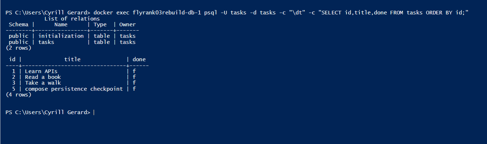

# Postgres task API rebuild

AI-assisted rebuild of flyrank-03-postgres and A1. Original repos/data preserved. Real chronological checkpoints, no hand-built authorship claim.

Requires Docker Desktop. Copy .env.example to .env and replace the example password in both fields. Run `docker compose up --build`. Open http://localhost:8103/docs. Isolated project/volume; database is on localhost:5543.

| Method | Endpoint | Result |
|---|---|---|
| GET | /tasks, /tasks/{id} | 200; 404 missing |
| POST | /tasks | 201; 400 invalid |
| PUT | /tasks/{id} | 200; 400 invalid; 404 missing |
| DELETE | /tasks/{id} | 204; 404 missing |

Tables and three seeds are automatic, only once. Parameterized queries handle CRUD. A named volume preserves tasks across compose down/up. Deleting volumes removes data. The unchanged A1 CRUD checkpoint passing across memory, SQLite and Postgres demonstrates that storage is an implementation detail behind the HTTP contract.

## Requirement checks
- [x] Actual Postgres and one-command Docker full stack checked.
- [x] Ignored .env and committed placeholders; no credentials committed.
- [x] Automatic table and three seeds only once.
- [x] Unchanged A1 CRUD test passes with 200/201/204/400/404 JSON errors.
- [x] Full compose down/up persistence checked at Stage 4.
- [x] New actual psql terminal screenshot supplied by user and live curl transcript recorded.
- [x] Public repo, six exact stage commits, run command, endpoint table.

Actual curl response (full transcript in verification.txt):

```http
HTTP/1.1 201 Created
date: Thu, 05 Nov 2026 07:36:24 GMT
server: uvicorn
content-length: 57
content-type: application/json
```



The user captured this screenshot from `flyrank03rebuild-db-1`, showing three seed rows and the row retained across full compose down/up. It is evidence from this rebuild, not the earlier project.
